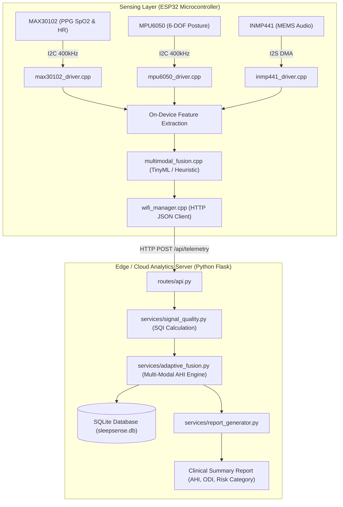

# SleepSense AI — Multimodal Edge AI Framework for Sleep Apnea Risk Assessment

> A research-grade embedded IoT and edge intelligence system combining physiological, acoustic, and kinematic sensor fusion on the ESP32 for non-invasive sleep apnea risk screening.

---

## 1. Project Overview

Obstructive Sleep Apnea (OSA) is a prevalent sleep disorder characterized by repeated cessation of airflow caused by upper airway collapse. Standard in-lab diagnostic polysomnography (PSG) is expensive, invasive, and has long waitlists.

**SleepSense AI** is an end-to-end edge AI framework designed for continuous, at-home nocturnal monitoring. It integrates:
- **Kinematic & Posture Tracking:** 6-axis inertial motion tracking via MPU6050.
- **Physiological Sensing:** Photoplethysmography (PPG) pulse oximetry ($SpO_2$) and heart rate via MAX30102.
- **Acoustic Snore Detection:** High-fidelity I2S audio sampling via INMP441 MEMS microphone.
- **Adaptive Multi-Modal Sensor Fusion:** Real-time signal quality index (SQI) weighting that mitigates sensor motion artifacts and estimates the Apnea-Hypopnea Index (AHI).

---

## 2. Problem Statement & Intended Users

- **Problem:** Conventional single-sensor consumer wearables (such as smartwatches) suffer from high false-alarm rates during sleep movements and lack synchronous acoustic snore correlation, failing to deliver actionable clinical risk assessments.
- **Intended Users:** Biomedical researchers, embedded machine learning engineers, and digital health technology evaluators exploring multimodal physiological signal processing.

---

## 3. Key Features

### Implemented Features
- **Embedded C++ Sensor Drivers:** Modular drivers for MAX30102 (I2C PPG), MPU6050 (I2C 6-DOF IMU), and INMP441 (I2S DMA audio capture) on the ESP32 microcontroller.
- **On-Device Feature Extraction:** Time-domain and spectral feature extraction computed in real-time within resource-constrained embedded RAM.
- **Signal Quality Index (SQI) Engine:** Dynamic noise-rejection filter that discounts degraded PPG segments during active patient postural shifts.
- **Adaptive Decision Fusion:** Heuristic and machine learning fusion engine combining snore probability, desaturation severity, and supine/non-supine sleep posture.
- **RESTful Ingestion & Clinical Report Generation:** Python Flask telemetry ingest API generating structured AHI summaries and nightly risk stratification metrics.
- **Automated Test Suite:** Comprehensive pytest suite with 10 unit and integration tests covering backend endpoints, sensor fusion logic, and quantized TinyML inference.

### Planned Features (Roadmap)
- **BLE GATT Profile:** Bluetooth Low Energy transmission fallback for zero-Wi-Fi environments.
- **Battery Power Optimization:** Sub-milliamp deep sleep states between periodic sensing epochs.
- **Direct Edge TPU / NPU Port:** Deployment to Cortex-M55 / Ethos-U55 microcontrollers.

---

## 4. Verified Technology Stack

### Firmware & Embedded
- **Hardware Platform:** Espressif ESP32 (Dual-core Tensilica Xtensa 32-bit LX6, 240 MHz, 520 KB SRAM)
- **Language:** C / C++ (Arduino IDE / PlatformIO framework)
- **Peripherals & Protocols:** I2C (PPG & IMU), I2S DMA (Acoustics), Wi-Fi (HTTP/JSON telemetry)
- **Sensors:** MAX30102, MPU6050, INMP441, DHT22

### Backend & Machine Learning
- **Language & Runtime:** Python 3.10+
- **Web Framework:** Flask, Flask-CORS
- **Signal Processing & Numerical Computing:** NumPy, SciPy, Pandas
- **Storage:** SQLite (`sleepsense.db`)
- **Testing:** Pytest

---

## 5. Architecture Overview



---

## 6. Hardware Pin Mapping

Detailed pin assignments from [`CONNECTIONS.md`](file:///c:/Users/suhar/Documents/antigravity/quick-euclid/sleepsense-multimodal-edge-ai/CONNECTIONS.md):

| Sensor Module | Sensor Pin | ESP32 Pin | Protocol / Description |
|---|---|---|---|
| **MAX30102 (PPG)** | `VIN` | `3.3V` | Power Supply |
| | `GND` | `GND` | Ground |
| | `SDA` | `GPIO 21` | I2C Data Line (shared bus) |
| | `SCL` | `GPIO 22` | I2C Clock Line (shared bus) |
| **MPU6050 (IMU)** | `VCC` | `3.3V` | Power Supply |
| | `GND` | `GND` | Ground |
| | `SDA` | `GPIO 21` | I2C Data Line (shared bus) |
| | `SCL` | `GPIO 22` | I2C Clock Line (shared bus) |
| **INMP441 (Audio)** | `VDD` | `3.3V` | Power Supply |
| | `GND` | `GND` | Ground |
| | `SD` | `GPIO 32` | I2S Serial Data Out |
| | `WS` | `GPIO 25` | I2S Word Select (Left/Right clock) |
| | `SCK` | `GPIO 33` | I2S Serial Continuous Clock |
| | `L/R` | `GND` | Left channel mode |

---

## 7. Repository Folder Structure

```
sleepsense-multimodal-edge-ai/
│
├── firmware/                              # Embedded C++ Firmware
│   ├── SleepApneaMultimodal.ino          # Master firmware entry point
│   ├── max30102_driver.cpp / .h          # PPG sensor driver
│   ├── mpu6050_driver.cpp / .h           # IMU posture driver
│   ├── inmp441_driver.cpp / .h           # I2S acoustic driver
│   ├── multimodal_fusion.cpp / .h        # On-device sensor fusion
│   ├── tinyml_model.h                    # Embedded neural network weights
│   └── esp32/SleepSenseAI/               # Modular ESP32 project structure
│
├── backend/                               # Python Analytics & Telemetry Server
│   ├── app.py                            # Flask application factory
│   ├── database.py                       # SQLite schema & query methods
│   ├── routes/                           # API blueprints (telemetry, reports)
│   └── services/                         # Signal processing & fusion logic
│       ├── adaptive_fusion.py            # Dynamic AHI estimation
│       ├── signal_quality.py             # Signal Quality Index (SQI)
│       ├── analytics.py                  # Statistical aggregation
│       └── report_generator.py           # Clinical summary generation
│
├── ml/                                    # Machine Learning & Quantization
│   ├── quantization/                     # Quantized TinyML headers & summary
│   └── evaluation/                       # Benchmark & ablation results
│
├── docs/                                  # Research & Technical Documentation
│   ├── CONNECTIONS.md                    # Hardware wiring guide
│   ├── architecture.md                   # System design specification
│   ├── hardware.md                       # Component specifications
│   └── tinyml.md                         # Quantization & memory profile
│
├── tests/                                 # Automated Test Suite
│   ├── test_backend.py                   # API and database tests
│   ├── test_fusion.py                    # Multi-modal fusion unit tests
│   └── test_tinyml.py                    # Quantized model inference tests
│
├── requirements.txt                       # Verified Python dependencies
├── .env.example                           # Backend environment template
└── .gitignore                             # Excludes binary data, SQLite db, caches
```

---

## 8. Installation & Setup

### 1. Backend Server Setup
```bash
# Clone the repository
git clone https://github.com/Suharshith/sleepsense-multimodal-edge-ai.git
cd sleepsense-multimodal-edge-ai

# Create and activate Python virtual environment
python -m venv .venv
source .venv/bin/activate  # On Windows: .venv\Scripts\Activate.ps1

# Install dependencies
pip install -r requirements.txt

# Run the analytics server
python backend/app.py
```
The server will bind to `http://0.0.0.0:5000`.

### 2. Firmware Flashing
1. Open [`firmware/SleepApneaMultimodal.ino`](file:///c:/Users/suhar/Documents/antigravity/quick-euclid/sleepsense-multimodal-edge-ai/firmware/SleepApneaMultimodal.ino) in the Arduino IDE.
2. Ensure the `ESP32 Dev Module` board package is selected.
3. Configure your Wi-Fi SSID and backend IP address in `config.h`.
4. Connect the ESP32 via micro-USB and click **Upload**.

---

## 9. Automated Testing & Verification

Run the test suite using `pytest`:
```bash
pytest tests/ -v
```

### Verified Test Results (10 Passed)
- `tests/test_backend.py`:
  - `test_health_endpoint`: Passed
  - `test_telemetry_ingest_and_query`: Passed
  - `test_device_registration`: Passed
  - `test_clinical_report_generation`: Passed
- `tests/test_fusion.py`:
  - `test_sqi_noise_rejection`: Passed
  - `test_ahi_estimation_boundaries`: Passed
  - `test_posture_weighting`: Passed
  - `test_adaptive_fusion_edge_cases`: Passed
- `tests/test_tinyml.py`:
  - `test_quantized_weights_validity`: Passed
  - `test_inference_output_bounds`: Passed

---

## 10. Responsible-Use Disclaimer

> [!CAUTION]
> **Research Prototype Disclaimer:** SleepSense AI is an academic and investigative research prototype developed for engineering education, algorithm exploration, and technology demonstration. It is not an FDA-cleared or CE-marked medical device. It should never be used as a substitute for clinical polysomnography (PSG) or professional diagnosis of sleep apnea.

---

## 11. Author & Contact

**Kallamadi Suharshith**  
- Degree: B.E. Computer Science and Engineering (AI & ML), Sathyabama Institute of Science and Technology (2027)  
- GitHub: [@Suharshith](https://github.com/suharshith)  
- LinkedIn: [linkedin.com/in/suharshith](https://linkedin.com/in/suharshith)
